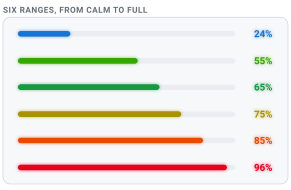
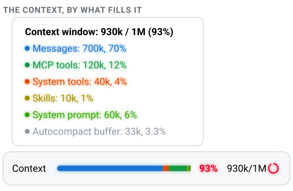
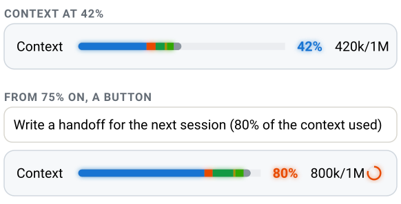
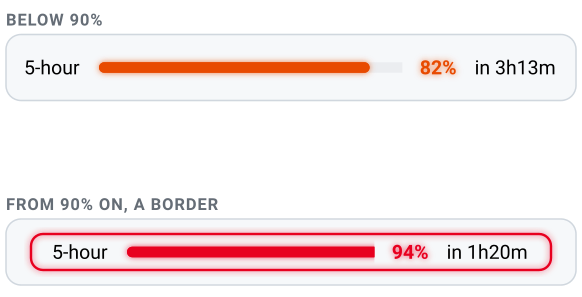
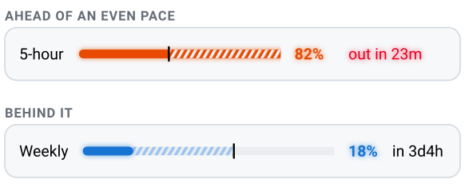
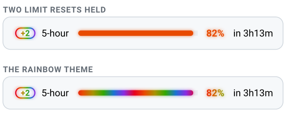

<h1 align="center">
  <picture>
    <source media="(prefers-color-scheme: dark)" srcset="design/readme/title-dark.svg">
    
  </picture>
</h1>

<p align="center">
  <a href="#install"><b>Install</b></a> &nbsp;·&nbsp;
  <a href="#configuration"><b>Configuration</b></a> &nbsp;·&nbsp;
  <a href="https://ivanpavlak.github.io/NeonMeter/docs/"><b>Documentation</b></a> &nbsp;·&nbsp;
  <a href="docs/options.md"><b>Every option</b></a> &nbsp;·&nbsp;
  <a href="CHANGELOG.md"><b>Changelog</b></a>
</p>

<p align="center">
  NeonMeter is a Claude Code plugin. It puts your 5-hour window, your weekly window, each per-model weekly limit your plan has, an optional spend limit and the session's context fill in a single row right above where you type, so you never have to run <code>/usage</code> or guess how far a conversation has drifted.
</p>

<p align="center">
  <picture>
    <source media="(prefers-color-scheme: dark)" srcset="design/readme/hero-dark.svg">
    
  </picture>
</p>

<p align="center">
  It follows your Claude Code theme and works in the terminal and in the desktop app's Code tab.
</p>

<h2 align="center" id="highlights">Highlights</h2>

<table>
  <tbody>
    <tr>
      <td width="50%" valign="top">
        <div align="center">
          <b>Reads at a glance</b>
          <br>
          <picture>
            <source media="(prefers-color-scheme: dark)" srcset="design/readme/highlights/ranges-dark.svg">
            
          </picture>
        </div>
        Six neon ranges, from calm dodgerblue under 50% to red at 90% and up. The color tells the story before the number does.
      </td>
      <td width="50%" valign="top">
        <div align="center">
          <b>Shows what fills the context</b>
          <br>
          <picture>
            <source media="(prefers-color-scheme: dark)" srcset="design/readme/highlights/context-dark.svg">
            
          </picture>
        </div>
        The context bar is split into your messages, the tools, the skills and everything else. In the desktop app, point at it and a card lists each one's tokens.
      </td>
    </tr>
  </tbody>
  <tbody>
    <tr>
      <td width="50%" valign="top">
        <div align="center">
          <b>Hands over in one click</b>
          <br>
          <picture>
            <source media="(prefers-color-scheme: dark)" srcset="design/readme/highlights/button-dark.svg">
            
          </picture>
        </div>
        From 75% of the context on, a glowing button appears at the end of the row. One click asks Claude to write a handoff for the next session, or sends any prompt you give it.
      </td>
      <td width="50%" valign="top">
        <div align="center">
          <b>Frames what runs high</b>
          <br>
          <picture>
            <source media="(prefers-color-scheme: dark)" srcset="design/readme/highlights/border-dark.svg">
            
          </picture>
        </div>
        From 90% on, a segment sits in a glowing border in its percent's color, so the limit about to bite stands out. An outline can run around the whole card as well.
      </td>
    </tr>
  </tbody>
  <tbody>
    <tr>
      <td width="50%" valign="top">
        <div align="center">
          <b>Tells you whether the pace holds</b>
          <br>
          <picture>
            <source media="(prefers-color-scheme: dark)" srcset="design/readme/highlights/pace-dark.svg">
            
          </picture>
        </div>
        Off by default: each window's bar marks where an even use of the limit would stand now, and warns when you would run out before the reset.
      </td>
      <td width="50%" valign="top">
        <div align="center">
          <b>Counts your resets, goes rainbow</b>
          <br>
          <picture>
            <source media="(prefers-color-scheme: dark)" srcset="design/readme/highlights/extras-dark.svg">
            
          </picture>
        </div>
        Off by default: a chip counts the limit resets you hold and lists them on hover, and a rainbow theme paints the whole band, still, breathing or circling.
      </td>
    </tr>
  </tbody>
</table>

There is more: the band pulses when a value changes, a per-model weekly limit takes turns with the week, a reading that went stale fades, and every open chat shares one fetch schedule. [Why you want it](docs/index.md#why-you-want-it) has the whole list.

<h2 align="center" id="documentation">Documentation</h2>

The full documentation is at **[ivanpavlak.github.io/NeonMeter](https://ivanpavlak.github.io/NeonMeter/docs/)**, and the same pages read on GitHub in [`docs/`](docs/):

- [Why you want it](docs/index.md#why-you-want-it): what the band shows and how it behaves
- [Install](docs/install.md): requirements, the terminal and the desktop app, uninstalling, troubleshooting
- [Configuration](docs/configuration.md): how to set options, common setups and the table of all forty-nine
- [Every option at a glance](docs/options.md): each option as a picture, desktop and terminal
- [Using it](docs/using-it.md): the segments, narrow chats, the border and outline, the pace, the reset chip, the rainbow, every chat, the context bar, the button and the handoff, the terminal, the color scheme
- [How usage is fetched](docs/how-it-works.md): the endpoint, the shared schedule and what the plugin touches
- [Known limitations](docs/limitations.md)
- [Resource use](docs/resource-use.md): what the pulse and the band cost
- [Development](docs/development.md): tests, benchmarking and releasing

<h2 align="center" id="install">Install</h2>

In a **terminal session** of Claude Code, one command adds this repository as a plugin marketplace and installs NeonMeter:

```text
/plugin install neonmeter --marketplace IvanPavlak/NeonMeter
```

From a shell, the same takes two commands:

```bash
claude plugin marketplace add IvanPavlak/NeonMeter
```

```bash
claude plugin install neonmeter@neonmeter
```

**In the desktop app**, the Code tab has no `/plugin` command. Paste this into the Code tab and Claude runs the two commands with the app's own copy of Claude Code:

```text
Install the NeonMeter plugin: run "$CLAUDE_CODE_EXECPATH" plugin marketplace add IvanPavlak/NeonMeter, then "$CLAUDE_CODE_EXECPATH" plugin install neonmeter@neonmeter, and show me the output of both.
```

It needs Claude Code 2.1.286 or newer; on 2.1.286 itself, plugin mods need one setting. [Install](docs/install.md) has the details, uninstalling and what to check when the band does not appear.

<h2 align="center" id="configuration">Configuration</h2>

Every option has a default, the approved design. Pipe the ones you want to change into `claude plugin configure`, every value as text in quotes:

```bash
echo '{"border":"always","outline":"sections","desktopBars":"dots"}' | claude plugin configure neonmeter@neonmeter --values-stdin
```

A change applies in the next session, or at once after `/reload-plugins`. [Configuration](docs/configuration.md) lists all forty-nine options and common setups, and [Every option at a glance](docs/options.md) shows each one as a picture.
