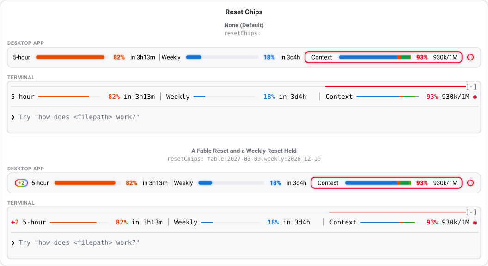

<h1 align="center">
  <picture>
    <source media="(prefers-color-scheme: dark)" srcset="design/readme/title-dark.svg">
    
  </picture>
</h1>

NeonMeter is a Claude Code plugin. It puts your 5-hour window, your weekly window (and each per-model weekly limit your plan has), an optional spend limit and the session's context fill in a single row right above where you type, so you never have to run `/usage` or guess how far a conversation has drifted. The row runs edge to edge, every bar is colored by how full it is, the context bar shows what fills the context and the band pulses when a value changes. Once the context runs high, a glowing button appears at the end of the row: one click asks Claude to write a handoff for the next session, or sends any prompt you give it. Three more things wait behind options, all off until you turn them on: a chip before the first segment that counts the limit resets you hold (`+2`) and lists them on hover, the one that expires first on top; the pace of each window, marked on its bar, with a warning when you would run out before the reset; and a rainbow theme for the whole band, still, breathing or circling. It follows your Claude Code theme and works in the terminal and in the desktop app's Code tab.

<p align="center">
  
</p>

<h2 align="center" id="reset-chip">The reset chip</h2>

Claude gives out limit resets now and then, and they expire. List the ones you hold and a rainbow chip stands at the start of the row with their count; in the desktop app, point at it for what each refills and when it expires, in red when that is close:

```bash
echo '{"resetChips":"fable:2027-03-09,weekly:2026-12-10"}' | claude plugin configure neonmeter@neonmeter --values-stdin
```

<p align="center">
  <picture>
    <source media="(prefers-color-scheme: dark)" srcset="design/readme/options/resetChips-dark.svg">
    
  </picture>
</p>

The chip only tells: a click on it does nothing, and a reset is used in Settings, under Usage. The plugin cannot read your resets from your account, so the list is yours to keep. [Using it](docs/using-it.md) has the rest, the pace and the rainbow included.

<h2 align="center" id="documentation">Documentation</h2>

The full documentation is at **[ivanpavlak.github.io/NeonMeter](https://ivanpavlak.github.io/NeonMeter/docs/)**, and the same pages read on GitHub in [`docs/`](docs/):

- [Why you want it](docs/index.md#why-you-want-it): what the band shows and how it behaves
- [Install](docs/install.md): requirements, the terminal and the desktop app, uninstalling, troubleshooting
- [Configuration](docs/configuration.md): how to set options, common setups and the table of all forty-nine
- [Every option at a glance](docs/options.md): each option as a picture, desktop and terminal
- [Using it](docs/using-it.md): the segments, narrow chats, the border and outline, the pace, the reset chip, the rainbow, every chat, the context bar, the button and the handoff, the terminal, the color scheme
- [How usage is fetched](docs/how-it-works.md): the endpoint, the shared schedule and what the plugin touches
- [Known limitations](docs/limitations.md)
- [Resource use](docs/resource-use.md): what the pulse and the band cost
- [Development](docs/development.md): tests, benchmarking and releasing

<h2 align="center" id="install">Install</h2>

In a **terminal session** of Claude Code, one command adds this repository as a plugin marketplace and installs NeonMeter:

```text
/plugin install neonmeter --marketplace IvanPavlak/NeonMeter
```

From a shell, the same takes two commands:

```bash
claude plugin marketplace add IvanPavlak/NeonMeter
```

```bash
claude plugin install neonmeter@neonmeter
```

**In the desktop app**, the Code tab has no `/plugin` command. Paste this into the Code tab and Claude runs the two commands with the app's own copy of Claude Code:

```text
Install the NeonMeter plugin: run "$CLAUDE_CODE_EXECPATH" plugin marketplace add IvanPavlak/NeonMeter, then "$CLAUDE_CODE_EXECPATH" plugin install neonmeter@neonmeter, and show me the output of both.
```

It needs Claude Code 2.1.286 or newer; on 2.1.286 itself, plugin mods need one setting. [Install](docs/install.md) has the details, uninstalling and what to check when the band does not appear.

<h2 align="center" id="configuration">Configuration</h2>

Every option has a default, the approved design. Pipe the ones you want to change into `claude plugin configure`, every value as text in quotes:

```bash
echo '{"border":"always","outline":"sections","desktopBars":"dots"}' | claude plugin configure neonmeter@neonmeter --values-stdin
```

A change applies in the next session, or at once after `/reload-plugins`. [Configuration](docs/configuration.md) lists all forty-nine options and common setups, and [Every option at a glance](docs/options.md) shows each one as a picture.

<h2 align="center" id="license">License</h2>

[MIT](LICENSE)
