<picture>
  <source media="(prefers-color-scheme: dark)" srcset="../design/readme/title-dark.svg">
  
</picture>

NeonMeter is a Claude Code plugin. It puts your 5-hour window, your weekly window (and each per-model weekly limit your plan has), an optional spend limit and the session's context fill in a single row right above where you type, so you never have to run `/usage` or guess how far a conversation has drifted. The row runs edge to edge, every bar is colored by how full it is, the context bar shows what fills the context and the band pulses when a value changes. Once the context runs high, a glowing button appears at the end of the row: one click asks Claude to write a handoff for the next session, or sends any prompt you give it. It follows your Claude Code theme and works in the terminal and in the desktop app's Code tab.

  

## Why you want it

- **Always in view**

The row sits above the prompt, not behind a command. You see the 5-hour window run up before a long task, and the reset time right next to it.

- **Reads at a glance**

Six neon ranges, from calm dodgerblue under 50% to red at 90% and up. The color tells the story before the number does.

- **Glows on the desktop**

In the desktop app every filled bar, dot and percent sits on a soft halo of its own color that breathes on an 800 ms cycle; turn `glow` off for a crisp row. In the terminal the same row is drawn in character cells with a color pulse.

- **Breathes when something changes**

By default the band breathes three times whenever a value changes, a percent, the context or the reading going stale, and holds its glow still in between, so it shows you what just moved and costs next to nothing while it waits. Set `pulseMode` to `always` for a breath that never stops; since 1.4.0 it looks as it did with less work behind it, with dots about a sixth less CPU and under a third of the GPU in the desktop app (see [Resource use](resource-use.md)).

- **Shows what fills the context**

The context bar is split into what the desktop app's own context indicator lists, in neon: your messages, the system tools, the MCP tools, the skills and everything else, then the autocompact buffer in grey. In the desktop app, point at the Context segment and a card lists each category's tokens and share of the window, in its color, glowing and pulsing with the band.

- **Hands over in one click**

From 75% of the context on, a round neon button colored by the context percent appears at the end of the row. One click sends a prompt as if you had typed it: by default one that writes `HANDOFF.md`, a handoff the next session reads to carry on without this conversation, with the task, the state of the work, the decisions, the files and commands that matter, the open problems, the next steps and the dead ends. `buttonPrompt` makes it any prompt you like, sent exactly as typed (`/compact` asks for what the 1.4 button did), and `buttonLabel` names it on hover. Clicked while Claude is working, the prompt runs as soon as the turn ends. The button can sit at either end or before Context, show at any fill, or stay off.

- **Frames what runs high**

From 90% on, a segment sits in a glowing neon border in its percent's color, so the limit about to bite stands out at a glance. It glows and breathes with the band. It can frame the whole row instead, show at any percent, take one color of your choosing, or stay off. An outline can also run around the whole card in the desktop app, in one color or with each section's stretch in its own.

- **Knows your plan**

When your account has a weekly limit for one model, the Weekly segment takes turns between the all-models week and that model, each with its own percent, color and reset. New per-model limits join by themselves.

- **Honest when it cannot know**

If the usage fetch fails or the reading is old, the window segments freeze, fade and show the reading's age. A per-model weekly limit comes only from the fetch, so when that has not landed for twice `pollSeconds` while Claude Code keeps the other windows fresh after each reply, that segment alone fades. The context segment comes from the session itself and is never stale.

- **In every chat**

Every open chat shows its own band, side by side in the desktop app's split view included, as the app draws each chat's band (seen on desktop app 2.42304.2 with Claude Code 2.1.299; earlier builds drew it for one chat per window). Set `everyChat` to `false` for one band: the chat you last sent a prompt in takes it, and the others give it up within a minute.

- **Light on your account**

Every open session shares one fetch schedule through the plugin store, so ten chats do not mean ten polls. It backs off on 429 and never sees, stores or logs your credential.

- **Yours to tune**

Forty-one options cover the colors, the range bounds, the glyph, the segments and their order, the layout (every segment in one row, or one at a time across the whole row), the pulse and when it runs, how each reset reads and whether it is colored by the time left, the context bar and its hover card, the button and its prompt, the border, the polling and the theme. The defaults are the approved design. For the lightest band, turn the pulse and the glow off: nothing then moves or glows, the button and the border included.
