# Every option at a glance

Each option below has a picture of its values, the desktop band above the terminal band, drawn by the plugin's own builder and drawings. The pictures hold still, so the pulse options (`pulse`, `pulseMode`, `pulseCount`, `pulseMs`, `buttonPulse`) and `rotateSeconds` have none; `theme` and `desktopTheme` are the pictures themselves: they follow your GitHub theme; the colors are your own; `buttonPrompt` and `buttonLabel` are text, and the `button` picture's card shows the built-in prompt's label; `borderAt` is the `border` picture's threshold, and `borderGlow` and `borderPulse` work as `buttonGlow` and `buttonPulse` do. Every picture shows the same account at 93% of the context, so the button shows at the end of each row and the Context segment sits in its border.

<h3><code>layout</code>: <code>all</code> or <code>single</code></h3>

Every segment in one row, or one segment across the whole row at a time, taking turns.

<picture>
  <source media="(prefers-color-scheme: dark)" srcset="../design/readme/options/layout-dark.svg">
  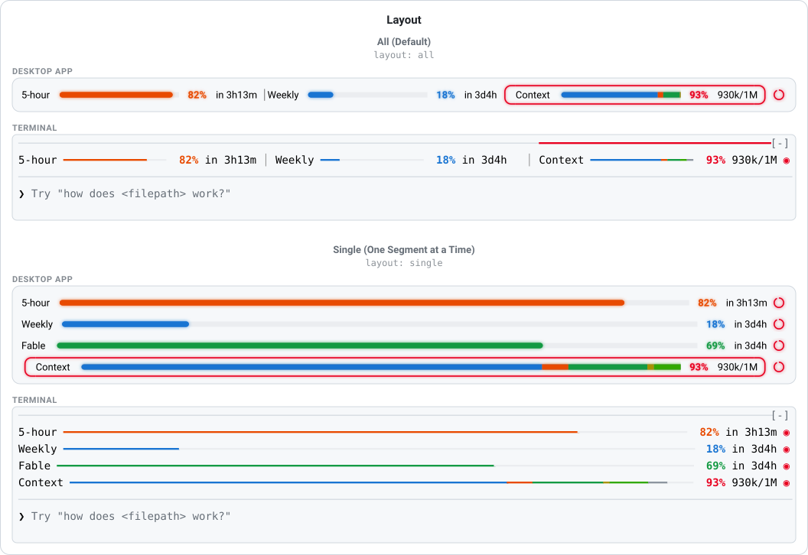
</picture>

<h3><code>barColoring</code>: <code>level</code> or <code>ramp</code></h3>

The whole fill in the percent's color, or the fill running through every range up to it.

<picture>
  <source media="(prefers-color-scheme: dark)" srcset="../design/readme/options/barColoring-dark.svg">
  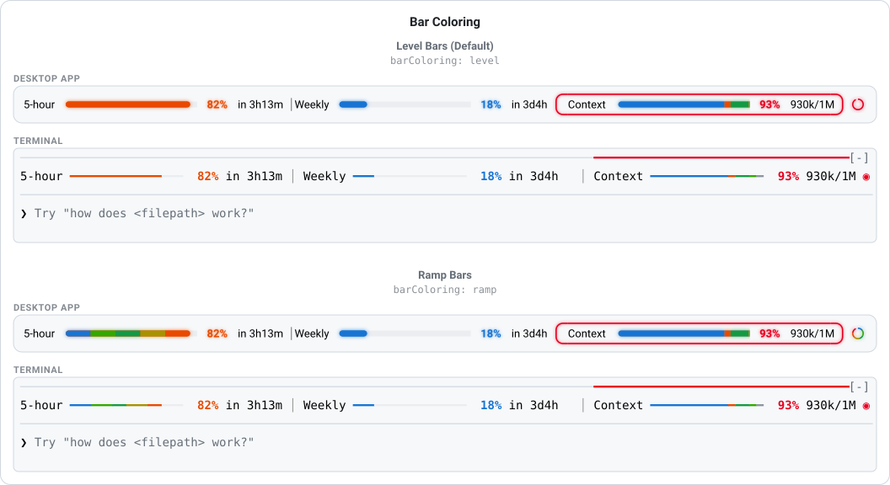
</picture>

<h3><code>desktopBars</code>: <code>bars</code> or <code>dots</code></h3>

Smooth glowing bars or rows of glowing dots, in the desktop app.

<picture>
  <source media="(prefers-color-scheme: dark)" srcset="../design/readme/options/desktopBars-dark.svg">
  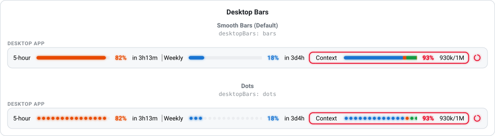
</picture>

<h3><code>glyph</code>: one character</h3>

The terminal's bar cell: <code>━</code> runs into a continuous bar, <code>●</code> or <code>■</code> make dotted ones.

<picture>
  <source media="(prefers-color-scheme: dark)" srcset="../design/readme/options/glyph-dark.svg">
  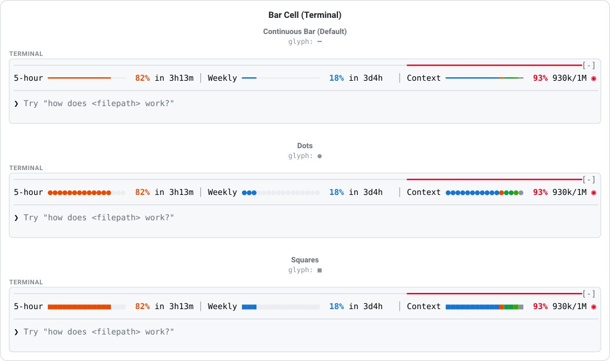
</picture>

<h3><code>glow</code>: <code>true</code> or <code>false</code></h3>

The desktop's halo under bars, dots and percents.

<picture>
  <source media="(prefers-color-scheme: dark)" srcset="../design/readme/options/glow-dark.svg">
  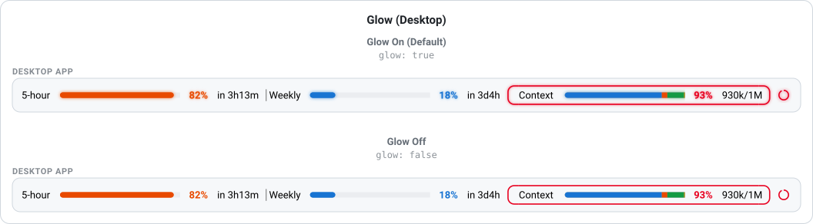
</picture>

<h3><code>segments</code>: a list</h3>

Which segments to draw and in what order.

<picture>
  <source media="(prefers-color-scheme: dark)" srcset="../design/readme/options/segments-dark.svg">
  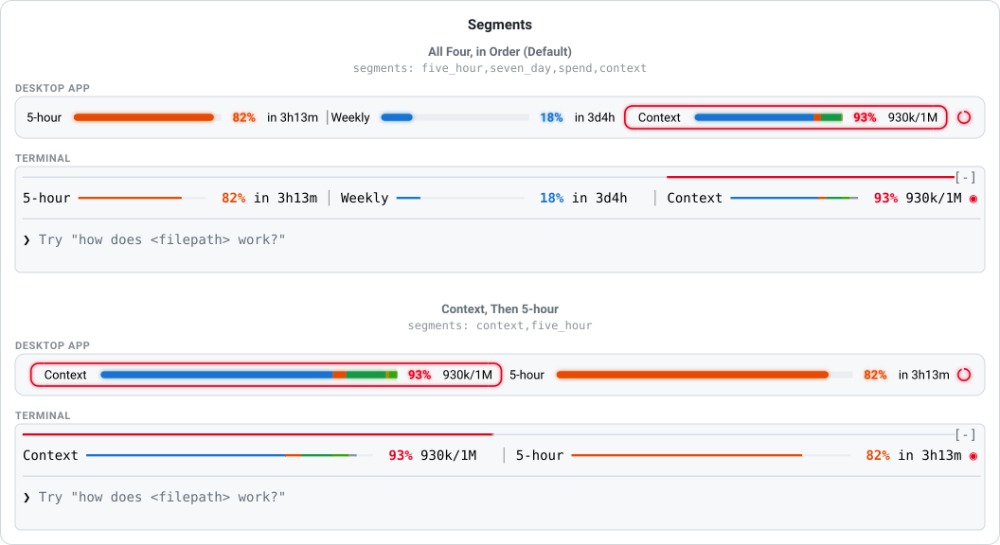
</picture>

<h3><code>ranges</code>: five bounds</h3>

Where each of the six colors starts for the percents.

<picture>
  <source media="(prefers-color-scheme: dark)" srcset="../design/readme/options/ranges-dark.svg">
  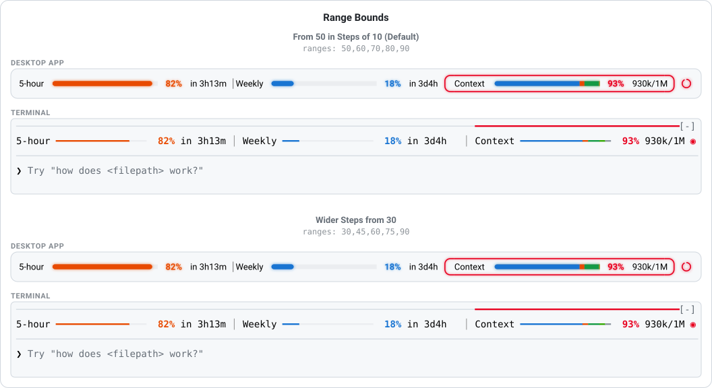
</picture>

<h3><code>fiveHourReset</code>: <code>countdown</code> or <code>clock</code></h3>

The 5-hour reset as the time left or the time it happens, on the widest layout.

<picture>
  <source media="(prefers-color-scheme: dark)" srcset="../design/readme/options/fiveHourReset-dark.svg">
  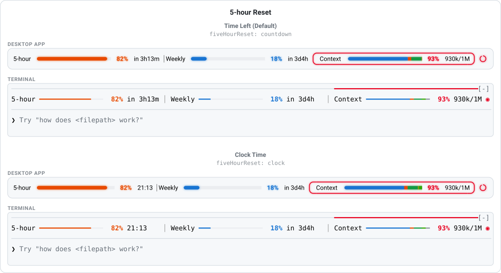
</picture>

<h3><code>weeklyReset</code>: <code>countdown</code> or <code>clock</code></h3>

Every weekly reset as the time left or the day and time, on the widest layout.

<picture>
  <source media="(prefers-color-scheme: dark)" srcset="../design/readme/options/weeklyReset-dark.svg">
  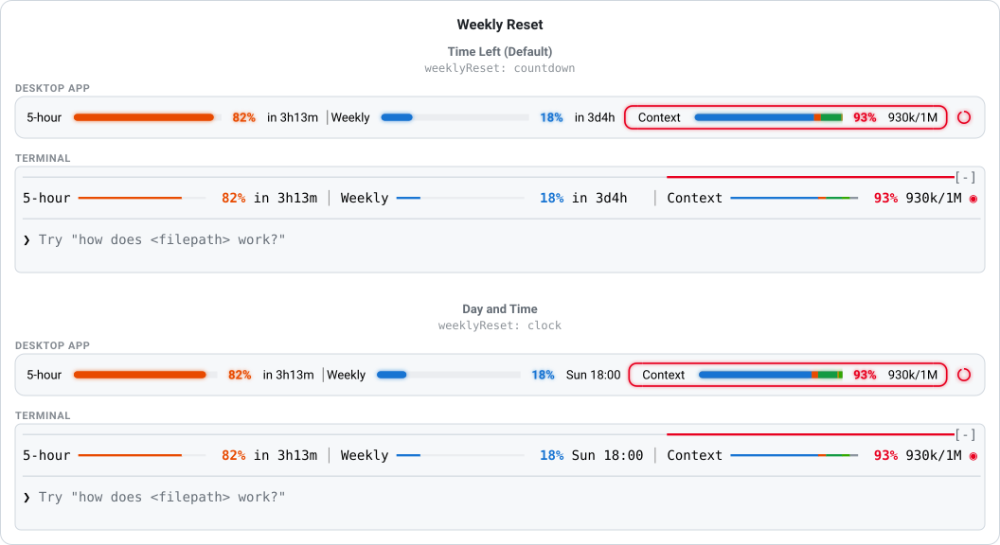
</picture>

<h3><code>resetColor</code>: <code>plain</code> or <code>time</code></h3>

Each reset in the text color, or colored by how much of its window is still to run, with the pulse and the glow.

<picture>
  <source media="(prefers-color-scheme: dark)" srcset="../design/readme/options/resetColor-dark.svg">
  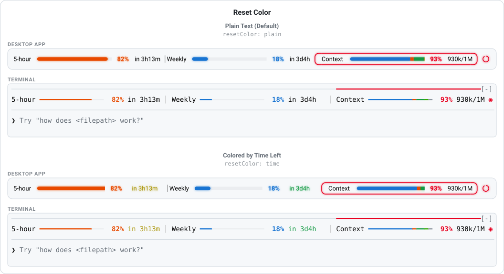
</picture>

<h3><code>timeRanges</code>: five bounds</h3>

Where each time color starts under <code>resetColor: time</code>; the default is six even steps of every window.

<picture>
  <source media="(prefers-color-scheme: dark)" srcset="../design/readme/options/timeRanges-dark.svg">
  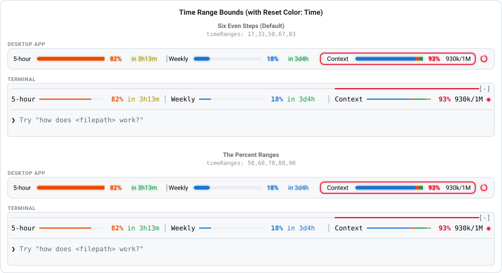
</picture>

<h3><code>contextBar</code>: <code>breakdown</code> or <code>percent</code></h3>

The context bar split by what fills the context, then the autocompact buffer in grey, or colored by its percent like every other bar.

<picture>
  <source media="(prefers-color-scheme: dark)" srcset="../design/readme/options/contextBar-dark.svg">
  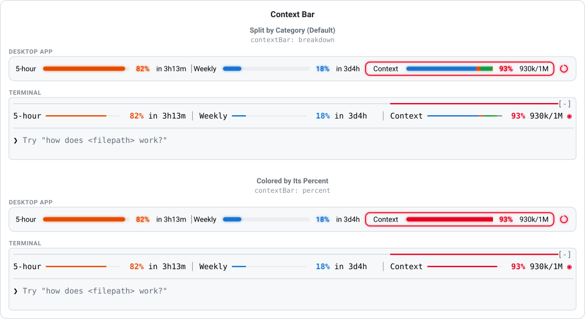
</picture>

<h3><code>contextPopup</code>: <code>true</code> or <code>false</code></h3>

The breakdown card the desktop app shows while the pointer is over the Context segment, drawn open.

<picture>
  <source media="(prefers-color-scheme: dark)" srcset="../design/readme/options/contextPopup-dark.svg">
  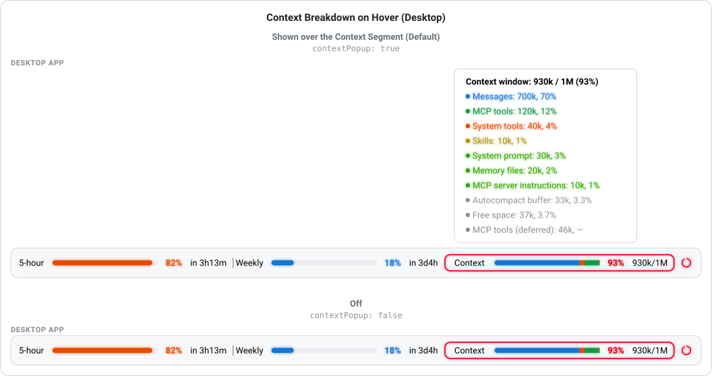
</picture>

<h3><code>button</code>: <code>appear</code>, <code>always</code> or <code>off</code></h3>

At 42% of the context: <code>appear</code> waits for <code>buttonAt</code> (75%), <code>always</code> shows the button at any fill. The card over it names what a click does: the built-in handoff prompt, or <code>buttonLabel</code>.

<picture>
  <source media="(prefers-color-scheme: dark)" srcset="../design/readme/options/button-dark.svg">
  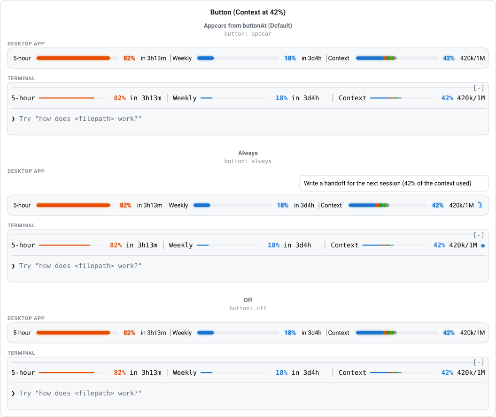
</picture>

<h3><code>buttonPosition</code>: <code>end</code>, <code>context</code> or <code>start</code></h3>

At the end of the row, before the Context segment or at the start.

<picture>
  <source media="(prefers-color-scheme: dark)" srcset="../design/readme/options/buttonPosition-dark.svg">
  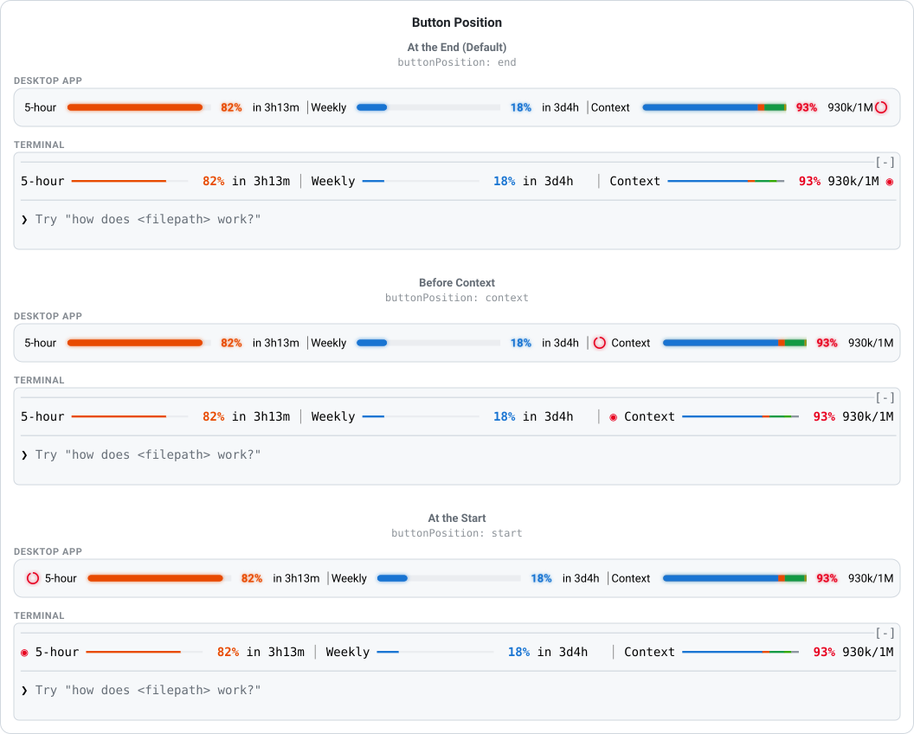
</picture>

<h3><code>buttonGlow</code>: <code>true</code> or <code>false</code></h3>

The button's halo, in the desktop app.

<picture>
  <source media="(prefers-color-scheme: dark)" srcset="../design/readme/options/buttonGlow-dark.svg">
  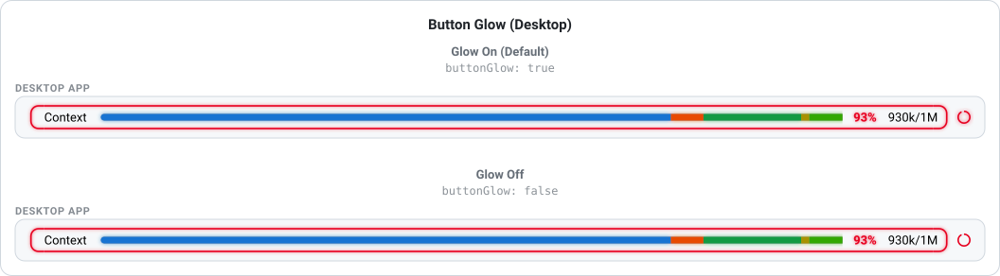
</picture>

<h3><code>border</code>: <code>appear</code>, <code>always</code> or <code>off</code></h3>

At 93% of the context: <code>appear</code> frames the Context segment alone, from <code>borderAt</code> (90%); <code>always</code> frames every segment in its own color. In the terminal the rule above a framed segment lights up.

<picture>
  <source media="(prefers-color-scheme: dark)" srcset="../design/readme/options/border-dark.svg">
  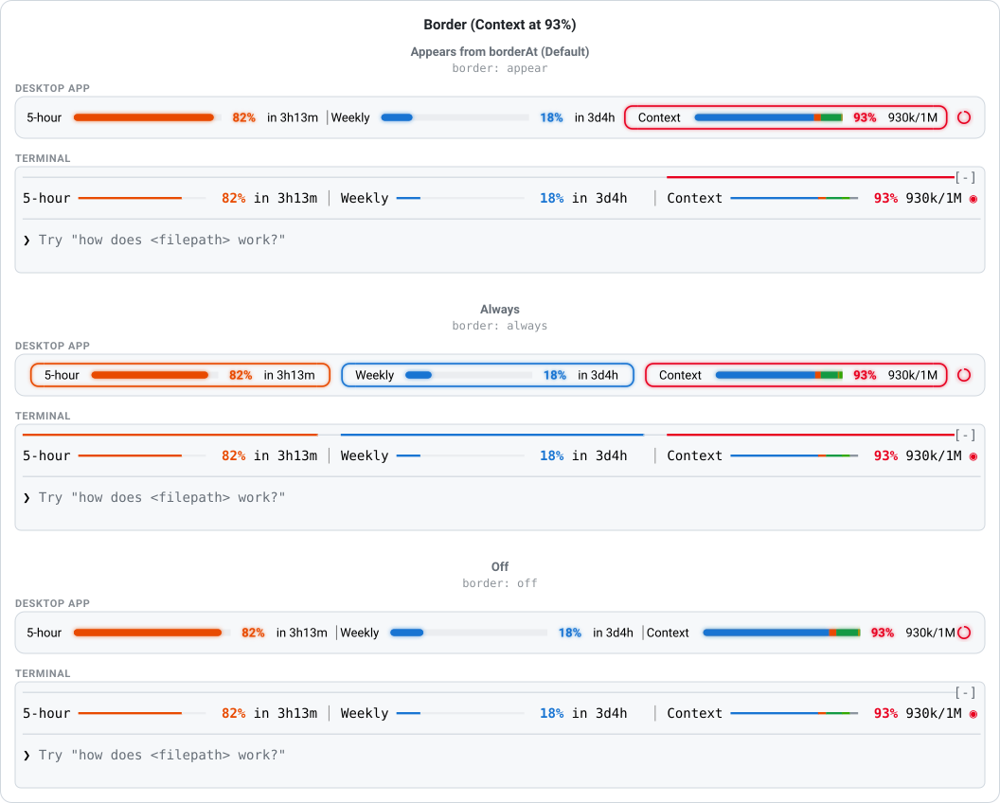
</picture>

<h3><code>borderScope</code>: <code>segment</code> or <code>band</code></h3>

With <code>border: always</code>: a border around each segment, or one around the whole band in its fullest segment's color.

<picture>
  <source media="(prefers-color-scheme: dark)" srcset="../design/readme/options/borderScope-dark.svg">
  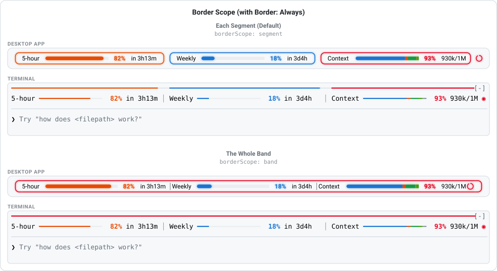
</picture>

<h3><code>borderColor</code>: empty or one color</h3>

With <code>border: always</code>: each border in its percent's color, or every border in the one color set.

<picture>
  <source media="(prefers-color-scheme: dark)" srcset="../design/readme/options/borderColor-dark.svg">
  
</picture>

<h3><code>outline</code>: <code>off</code>, <code>single</code> or <code>sections</code></h3>

At 93% of the context: a border around the whole card in place of the Context segment's own, in one color or with each section's stretch in its own; in the terminal, the whole rule.

<picture>
  <source media="(prefers-color-scheme: dark)" srcset="../design/readme/options/outline-dark.svg">
  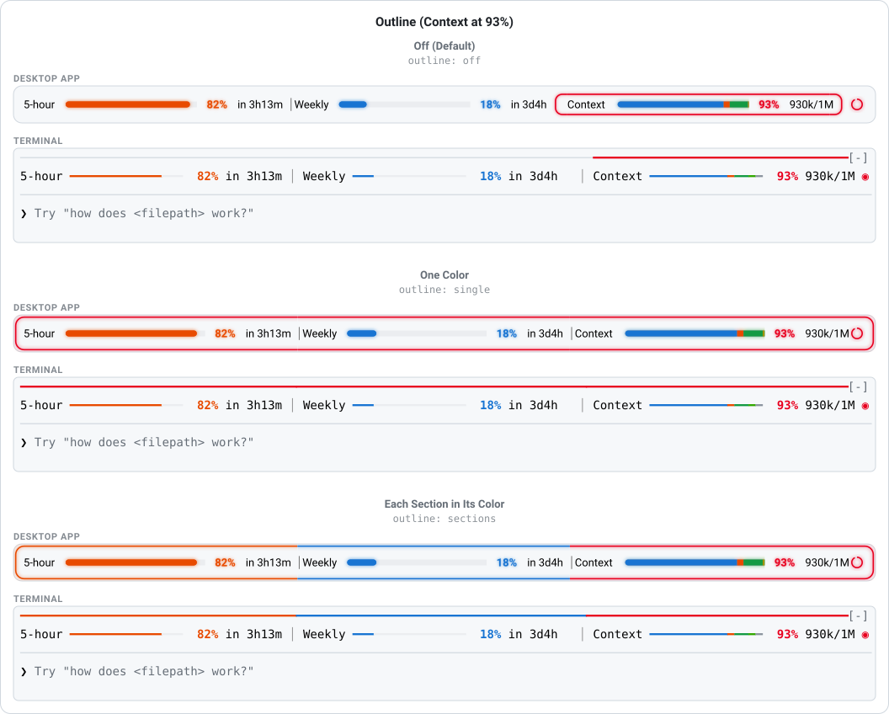
</picture>
