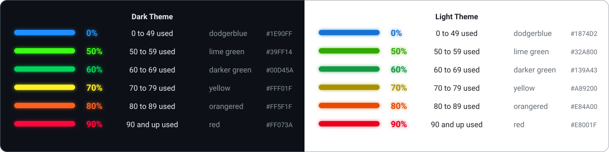

# Using it

Left to right the row shows:

- **5-hour**
- **Weekly**
- **Spend**
    - only when your account reports a spend limit
- **Context**

Each window segment is its label, a bar, the percent used and its reset: every window counts down to it, `in 3h13m` for the 5-hour window and `in 3d4h` for a weekly limit on the widest layout, `3h13m` and `3d4h` on narrower ones. `fiveHourReset` and `weeklyReset` switch either one to the other form, and `resetColor` set to `time` colors the reset by how much of its window is still to run. The context segment shows the percent and the tokens used against the model's window. The band is the strip Claude Code gives the plugin above the prompt; the row is the single line of cells or drawings it holds.

**In the desktop app** the band shows the full labels and the bars stretch to fill whatever room the text leaves. Bars are smooth with rounded ends by default, or a row of dots with `desktopBars` set to `dots`. Everything filled glows. In a narrow chat, a split view's pane say, the row steps down until it fits, as the terminal's layouts do: the segment borders give way first (the outline stays), then the labels shorten (`5h`, `7d`, `Ctx`), then the resets lose their `in ` and the context its token count, then the fields go, and last the bars (sketched here in text):

```text
5-hour ━━━━━━  22% in 2h57m │ Weekly ━━━━━━  3% in 2d9h │ Context ━━━━━━  57% 566k/1M ◉
5h ━━━━  22% in 2h57m │ 7d ━━━━  3% in 2d9h │ Ctx ━━━━  57% 566k/1M ◉
5h ━━━  22% 2h57m │ 7d ━━━  3% 2d9h │ Ctx ━━━  57% ◉
5h ━━  22% │ 7d ━━  3% │ Ctx ━━  57% ◉
5h 22% │ 7d 3% │ Ctx 57% ◉
```

**The border** marks what runs high. With the defaults, a segment that reaches 90% sits in a rounded neon frame in its own range color, red from 90 up, and the separator beside it gives way to a space; at 92% on the 5-hour window and 40% elsewhere, only the 5-hour segment is framed. It glows and breathes with the band: three breaths after a change under the default `pulseMode`, or all the time under `always`. Some ways to set it:

- `{"border":"always"}` frames every segment, each in its own color: a calm blue frame at 30%, a red one at 95%.
- `{"borderAt":"75"}` frames a segment from 75% on, in its range color: yellow at 75, orangered at 85, red from 90.
- `{"borderScope":"band"}` draws one frame around the whole row instead, in the color of its fullest segment.
- `{"outline":"sections"}` draws one border along the edges of the whole card instead of the segment borders, each section's stretch in its own color: orangered over the 5-hour window at 82%, dodgerblue over the weekly limit at 18%, red over the context at 93%. `{"outline":"single"}` draws it in one color, the fullest segment's.
- `{"outline":"single","border":"always","borderColor":"#FF073A"}` keeps the card's border always on, in red.

In the terminal the band is one row of cells, so a border lights the rule above the row instead: a `━` stretch in the border's color over each framed segment, or across the whole rule for `borderScope: band` and the outline.

**In every chat** the band shows by default, each chat its own, side by side in the desktop app's split view too. With `{"everyChat":"false"}` one chat shows it: the one you last sent a prompt in.

**The context bar** is split by what fills the context, as the desktop app's own context indicator splits it: Messages in dodgerblue, System tools in orangered, MCP tools in darker green, Skills in yellow and everything else (the system prompt, memory files, MCP server instructions, agents) as Other in lime, together as long as the percent says, then the autocompact buffer in grey, the room the engine keeps free for compacting, which neither glows nor pulses. The percent keeps its range color, so 93% still reads red. The breakdown is the engine's own estimate, the one `/context` lists, counted locally after each response; `contextBar` set to `percent` colors the bar by its percent instead, like the others. **In the desktop app, point at the Context segment** and a card opens above it with everything the app's own context panel lists: the window's fill (`Context window: 61.8k / 1M (6%)`), then Messages, System tools, MCP tools and Skills in their colors and the system prompt, memory files, MCP server instructions and agents each on its own row in Other's color, largest first, with their tokens and share of the window (`Messages: 25.5k, 2.6%`), glowing and pulsing with the band, then the autocompact buffer, the free space and the tools loaded on demand, which sit outside the window; `contextPopup` turns the card off.

**The button** is a ring the size of the app's own context ring beside the model picker: the track, and the context percent drawn over it in its range color (every range up to it under ramp coloring), glowing and pulsing with the band. It appears from 75% of the context on (`button`, `buttonAt`), at the end of the row (`buttonPosition`), and a click submits a prompt as if you had typed it. The engine runs a plugin's prompt once the session is idle, so a click while Claude works waits for the turn to end. In the desktop app the pointer on it shows the app's own button highlight and a card naming what it does; in the terminal it is a `◉` cell in the same color, at the same place, and a click on it does the same where the terminal reports clicks.

**The handoff** is what the button asks for by default: a `HANDOFF.md` in the project root, written for a reader who has the repository but not the conversation, so the next session can carry on where this one stops, before the context runs out or when you want to start fresh. The prompt asks for facts, not the story of how they were found, specific down to paths, commands and exact error text, honest about what is not done, not verified or uncertain, free of secrets, and as short as it can be while complete. It asks for these sections, each left out when empty: the task, in your own words where they matter, and what finished looks like; the state of the work, what is done and verified, done but not verified, in progress and not started, with the branch and what the working tree holds uncommitted; the decisions and why, what was rejected, and every instruction or correction you gave; a map of the files that matter, the entry points and the commands that were seen to work; the open problems, with exact output; the next steps in order, the first concrete enough to start at once; and the dead ends, so they are not tried again. It also tells Claude to read an existing `HANDOFF.md` first and keep only what is still true, to commit nothing and change no other file, and to end with the line to paste into the next session: `Read HANDOFF.md and continue from its next steps.` The exact text is in `hooks/handoff.ts`. `buttonPrompt` replaces it with any prompt of yours, sent exactly as typed, a slash command included: `/compact` asks for the compaction the button ran before 1.5.0, and a command of your own (a skill with a `/wrap-up` command, say) for whatever that command does. Whether the engine runs a slash command a plugin sends as a command, rather than reading it as text, is not confirmed in 1.5.0; a prompt in words always reaches Claude. `buttonLabel` names the action on the desktop's card; empty, the card names the built-in prompt, or a custom prompt by its first line.

**In the terminal** the row is built from character cells and picks the most detailed layout that fits the width, from full labels and wide bars down to a text-only line:

<p align="center">
  
</p>

The terminal band opens with a rule in the input box's border color, the same line the input box has at its top. The `[-]` at its right end is Claude Code's own button for collapsing the band; `ctrl+x ctrl+a` does the same. While a border shows, the rule's stretch above the framed segment (all of it under `borderScope: band`) is drawn `━` in the border's color and pulses with the row.

**With `layout` set to `single`** the band shows one segment at a time across the whole row and takes turns, `rotateSeconds` each: 5-hour, Weekly, then each per-model weekly limit, the spend limit when your account has one, and Context, in the order of `segments`. Every bar style works the same way: ramp or level coloring, the terminal's cells, and the desktop's smooth bars or dots. Both graphics group their examples by layout: **Layout: All (Default)** first, then **Layout: Single (One Segment at a Time)**, each in four looks: level bars (the default), ramp bars, and dots in either coloring (on the desktop `desktopBars: dots`, in the terminal `glyph` set to `●`). Dots follow `barColoring` like bars do: under `level` every filled dot takes the percent's color, under `ramp` the filled dots run through the ranges. For one glowing dot bar at a time, colored by its percent (the default level coloring):

```json
{
	"pluginConfigs": {
		"neonmeter": {
			"options": {
				"layout": "single",
				"desktopBars": "dots"
			}
		}
	}
}
```

What the states mean:

- **Pulse**

Live cells and percents brighten toward white and back on an 800 ms cycle, all in phase; on the desktop the halo widens with them. Labels, separators and empty cells stay still. By default the pulse runs three cycles each time a value changes and the band holds still in between; a session start and a turn of the Weekly rotation are no change (`pulseMode` and `pulseCount` below).

- **Stale**

The usage fetch failed or the last reading is older than twice the poll interval: the window segments freeze and fade and the row shows the reading's age. Narrow terminal layouts put a `~` before each window percent instead.

- **First load**

Until the first reading lands, the window bars are grey loading cells and the percent is `…`, pulsing under `pulseMode: always`; the reading arriving is a change, so the band pulses then by default.

- **No subscription**

Signed in with an API key or without a first-party credential, the window segments are hidden and the context takes the whole row.

- **Before the first response**

The context bar is empty and shows `--` until the model has answered once, and the button waits too: there is no conversation to hand on yet.

## The color scheme

<p align="center">
  
</p>

Filled cells and percents take the color of the range the percent falls in. A range includes its lower bound, so 50 is lime green and anything from 90 up is red. Under the default `level` coloring the whole bar takes the percent's color. With `barColoring` set to `ramp` the filled part runs through every range from the first up to the percent's, in equal stretches, so an 85% bar runs blue, lime, darker green, yellow, orangered and a 69% bar runs blue, lime, darker green. The light palette is the same six hues darkened for a white ground. The button's ring takes the context percent's colors the same way.

The context bar's categories have six colors of their own, the desktop app's hues in neon: Messages dodgerblue, System tools orangered, MCP tools darker green, Skills yellow, Other lime, and the autocompact buffer grey (`contextColorsDark` and `contextColorsLight` change them).
